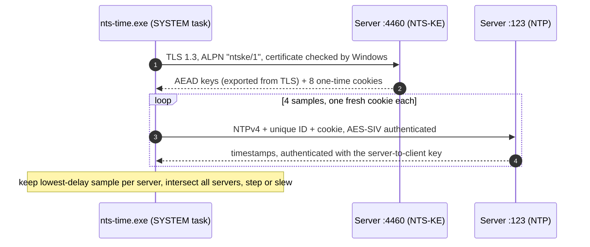

[ci-badge]: https://github.com/johnzfitch/nts-time/actions/workflows/ci.yml/badge.svg
[ci]: https://github.com/johnzfitch/nts-time/actions/workflows/ci.yml
[releases]: https://github.com/johnzfitch/nts-time/releases/latest
[release-badge]: https://img.shields.io/github/v/release/johnzfitch/nts-time?label=release
[license-badge]: https://img.shields.io/badge/license-MIT%20OR%20Apache--2.0-blue
[rfc8915]: https://www.rfc-editor.org/rfc/rfc8915
[ntpd-rs]: https://github.com/pendulum-project/ntpd-rs
[ntp-proto]: https://crates.io/crates/ntp-proto
[sts]: https://learn.microsoft.com/en-us/windows-server/networking/windows-time-service/windows-time-service-tools-and-settings
[precise]: https://learn.microsoft.com/en-us/windows/win32/api/sysinfoapi/nf-sysinfoapi-setsystemtimeadjustmentprecise

nts-time
========

**Authenticated time for Windows.** Your PC's clock syncs over plain <abbr title="Network Time Protocol">NTP</abbr>, which anyone on the network path can spoof. nts-time switches it to <abbr title="Network Time Security">NTS</abbr> ([RFC&nbsp;8915][rfc8915]), so every time reply is cryptographically tied to a TLS-verified server.

[![CI][ci-badge]][ci] [![Release][release-badge]][releases] ![License][license-badge]

> [!NOTE]
> Windows' built-in time service (W32Time) has no NTS support, and the well-known NTS clients (chrony, NTPsec, ntpd-rs) don't run on Windows. nts-time fills that gap with one small `.exe` and a scheduled task. No background service, no driver, no installer framework.

---

Quick start
-----------

<kbd><kbd>Win</kbd>+<kbd>X</kbd></kbd> &rarr; **Terminal (Admin)**, then:

```powershell
# 1. Download and unpack the latest release
$v = (Invoke-RestMethod https://api.github.com/repos/johnzfitch/nts-time/releases/latest).tag_name
$zip = "nts-time-$($v.TrimStart('v'))-windows-x64.zip"
Invoke-WebRequest "https://github.com/johnzfitch/nts-time/releases/download/$v/$zip" -OutFile $zip
Expand-Archive $zip -DestinationPath . -Force
cd ($zip -replace '\.zip$')

# 2. Allow the downloaded scripts to run (they're unsigned)
Get-ChildItem | Unblock-File

# 3. Look first: query the NTS servers and print what would change (changes nothing)
.\install.ps1 -DryRun

# 4. Install
.\install.ps1
```

You should see something like this:

```text
time.cloudflare.com          offset -0.844585 s  delay 0.004601 s  stratum 3  (4 of 4 samples ok)
nts.netnod.se                offset -0.848586 s  delay 0.164270 s  stratum 1  (4 of 4 samples ok)
ptbtime1.ptb.de              offset -0.842812 s  delay 0.160639 s  stratum 1  (4 of 4 samples ok)
nts.time.nl                  offset -0.843683 s  delay 0.144256 s  stratum 1  (4 of 4 samples ok)
virginia.time.system76.com   offset -0.843419 s  delay 0.074018 s  stratum 2  (4 of 4 samples ok)
agreeing: time.cloudflare.com, nts.netnod.se, ptbtime1.ptb.de, nts.time.nl, virginia.time.system76.com -> 5 of 5 responding servers agree
dry run: would correct -0.843683 s
```

Then the install steps the clock and prints <samp>action: stepped clock by -0.847376 s (measured -0.847048 s)</samp>. That's it. It now re-syncs at boot and every 15&nbsp;minutes.

<details>
<summary><b>Verify the download before running it</b></summary>

Every release is built by GitHub Actions from the tagged source, and it carries a signed [build provenance attestation](https://docs.github.com/actions/security-for-github-actions/using-artifact-attestations). With the [GitHub CLI](https://cli.github.com/):

```powershell
gh attestation verify $zip --repo johnzfitch/nts-time
```

Or compare against the release's `SHA256SUMS.txt`:

```powershell
(Get-FileHash $zip -Algorithm SHA256).Hash.ToLower()
```

</details>

<details>
<summary><b>Build from source instead</b></summary>

Needs a Rust toolchain (MSVC target) from [rustup.rs](https://rustup.rs).

```powershell
git clone https://github.com/johnzfitch/nts-time
cd nts-time
cargo build --release --locked
.\install.ps1 -DryRun
.\install.ps1          # picks up target\release\nts-time.exe
```

</details>

---

What the installer changes
--------------------------

Everything it touches is listed here, and `uninstall.ps1` reverses all of it.

| | Before | After |
|:--|:--|:--|
| Time source | W32Time, plain NTP to `time.windows.com` | `nts-time.exe` over NTS, 5 independent operators |
| W32Time `Parameters\Type` | `NTP` | `NoSync` |
| W32Time Secure Time Seeding[^sts] (`Config\UtilizeSslTimeData`) | `1` | `0` |
| Tasks `\Microsoft\Windows\Time Synchronization\*` | Ready | Disabled |
| New scheduled task | &mdash; | `\nts-time\Sync`, runs as SYSTEM at boot (+1&nbsp;min) and every 15&nbsp;min |
| Program | &mdash; | `%ProgramFiles%\nts-time\nts-time.exe` |
| Data | &mdash; | `%ProgramData%\nts-time\` (log, backup; writable by SYSTEM and Administrators only) |

Your original W32Time settings are saved once, to `%ProgramData%\nts-time\w32time-backup.json`, before anything changes. A reinstall never overwrites that backup.

The installer checks existing program/data directories, logs, and backups before writing to them. It refuses reparse points (including junctions and symbolic links), untrusted owners, and files or directories writable by untrusted principals. Existing SYSTEM, Administrators, and Windows TrustedInstaller permissions are trusted. Installed directories receive a protected ACL granting SYSTEM and Administrators full access and Users read/execute access. Keep `install-security.ps1` next to `install.ps1`; both are included in release archives.

> [!WARNING]
> Turning <mark>Settings &rarr; Time &amp; language &rarr; Set time automatically</mark> back **on** switches W32Time back to plain NTP. It will then fight nts-time over the clock. Leave it off, or run `uninstall.ps1` first.

---

How it works
------------



Each run is one shot: it queries every server, decides, corrects, and exits. The protocol work (NTS-KE, cookies, `AEAD_AES_SIV_CMAC`, packet parsing and response validation) comes from [`ntp-proto`][ntp-proto], the library behind [ntpd-rs][ntpd-rs]. It's pinned to an exact version because its API is internal. The application code in [`src/`](src) handles server selection, clock control and logging.

### The rules it won't bend

<dl>
  <dt>&#x1F512;&ensp;Authenticated or nothing</dt>
  <dd>A reply is dropped if its NTS authenticator doesn't decrypt, if our unique identifier and origin timestamp aren't echoed inside the authenticated part, if it's a kiss-o&rsquo;-death, if the server says it's unsynchronised, or if its root distance is over 1&nbsp;s. Malformed and oversized packets do not prevent a later valid reply from being accepted within the same fixed deadline. Cookies are never reused.</dd>
  <dt>&#x2696;&#xFE0F;&ensp;Independent agreement</dt>
  <dd>Each server's lowest-delay sample becomes an interval <var>offset</var>&nbsp;&plusmn;&nbsp;(<var>delay</var>/2&nbsp;+&nbsp;<var>root&nbsp;delay</var>/2&nbsp;+&nbsp;<var>root&nbsp;dispersion</var>&nbsp;+&nbsp;2&nbsp;ms). With the default <code>--min-agree 3</code>, the clock moves only if intervals from at least <b>3 distinct operators</b>, and a <b>majority</b> of the servers that responded, overlap. Selection considers the operator requirement while finding an overlap, then clamps the median correction to the intersection of every selected interval. Lowering <code>--min-agree</code> explicitly weakens the operator requirement.</dd>
  <dt>&#x1F4CF;&ensp;Bounded corrections</dt>
  <dd>By default, offsets over 1&nbsp;day are refused and offsets of 128&nbsp;ms or more are <dfn>stepped</dfn>. Smaller ones are <dfn>slewed</dfn> at 500&nbsp;ppm. Numeric settings must be finite, and the slew rate cannot exceed 500&nbsp;ppm. A slew that would take longer than five minutes, or whose rate cannot be represented, falls back to a step. Every slew is measured against the hardware performance counter. If it misses by more than half, the remainder is stepped and the run is flagged.</dd>
  <dt>&#x1F9F9;&ensp;No leftovers</dt>
  <dd>Every run starts by resetting the clock rate to nominal, so a run killed mid-slew can't leave the clock running fast or slow.</dd>
</dl>

### Default servers

| Host | Operator | Notes |
|:--|:--|:--|
| `time.cloudflare.com` | Cloudflare | anycast, usually nearest |
| `nts.netnod.se` | Netnod | Swedish national time, stratum&nbsp;1 |
| `ptbtime1.ptb.de` | PTB | German national metrology institute, stratum&nbsp;1 |
| `nts.time.nl` | SIDN Labs | Netherlands, stratum&nbsp;1 |
| `virginia.time.system76.com` | System76 | US East |

Far-away servers add path asymmetry, typically a few milliseconds. The interval intersection accounts for that by widening each interval by half the round-trip delay. To use closer servers, pass `host=operator` pairs. Servers with the same operator count once toward the 3-operator rule:

```powershell
.\install.ps1 -Servers "time.cloudflare.com=cloudflare,ohio.time.system76.com=system76,nts.netnod.se=netnod,ptbtime2.ptb.de=ptb"
```

Hostnames and operator names are case-insensitive. Empty entries, duplicate hostnames (including case/trailing-dot variants), and impossible operator quorums are rejected before network access or clock changes. Operator names must use letters, digits, `.`, `_`, `-`, or `:`. Assign operator groups accurately: the client cannot determine whether different DNS names belong to the same operator.

---

Reference
---------

<details>
<summary><b><code>nts-time.exe</code> flags</b></summary>

| Flag | Default | Meaning |
|:--|:--|:--|
| *(none)* | | Dry run: query, decide, print, change nothing |
| `--apply` | off | Actually correct the clock (needs SYSTEM or an elevated prompt) |
| `--servers host=op,...` | built-in list | Servers and their operator groups |
| `--samples N` | `4` | Requests per server, 1&ndash;8 |
| `--min-agree N` | `3` | Distinct operators that must agree |
| `--max-offset SECS` | `86400` | Refuse corrections larger than this |
| `--step-threshold SECS` | `0.128` | Step at or above this, slew below |
| `--max-slew-ppm PPM` | `500` | Finite slew rate, greater than 0 and at most 500; slews over five minutes fall back to a step |
| `--log FILE` | none | Append one JSON line per run (every sample, the selection, the action) |
| `--slew-test` | | Diagnostic: runs 0, +500, &minus;500, 0&nbsp;ppm for 10&nbsp;s each and prints the drift actually measured. Needs admin, and moves the clock by &lt;&nbsp;5&nbsp;ms |
| `--version` | | Print version |

Exit codes: <samp>0</samp> ok &middot; <samp>1</samp> error &middot; <samp>2</samp> servers didn't agree, clock untouched &middot; <samp>3</samp> offset over `--max-offset`, clock untouched &middot; <samp>64</samp> bad arguments.

`install.ps1` takes `-Servers`, `-IntervalMinutes` (default 15) and `-DryRun`.

Use `--version` and `--slew-test` on their own. Combining a diagnostic option with other flags is rejected, so a command such as `--slew-test --version` cannot accidentally move the clock.

</details>

<details>
<summary><b>Reading the log</b></summary>

Every run is one line in `%ProgramData%\nts-time\runs.jsonl`, about 2&nbsp;KB per run (roughly 70&nbsp;MB a year at 15-minute runs). Summary:

```powershell
Get-Content $env:ProgramData\nts-time\runs.jsonl -Tail 10 | ForEach-Object {
  $r = $_ | ConvertFrom-Json
  '{0:yyyy-MM-dd HH:mm:ss}  {1}' -f [DateTimeOffset]::FromUnixTimeSeconds([long]$r.started_unix).LocalDateTime, $r.action
}
```

A healthy steady state looks like small slews whose requested and measured amounts match:

<samp>slewed clock by -0.002381 s over 4.8 s at 500.0 ppm (measured -0.002381 s)</samp>

Cross-check against an independent server at any time (plain NTP, read-only):

```powershell
w32tm /stripchart /computer:time.nist.gov /dataonly /samples:3
```

</details>

<details>
<summary><b>Troubleshooting</b></summary>

<dl>
  <dt><samp>NTS-KE connect timed out</samp> for every server</dt>
  <dd>Outbound <b>TCP&nbsp;4460</b> (key exchange) or <b>UDP&nbsp;123</b> (NTP) is blocked by a firewall or network. Both are needed.</dd>
  <dt><samp>NTS-KE: &hellip; certificate &hellip;</samp></dt>
  <dd>TLS needs a roughly correct date to check certificates. If the clock is off by months, for example after a dead <abbr title="real-time clock">RTC</abbr> battery, set the date by hand once, then run again. This is deliberate: nts-time never trusts unauthenticated time to bootstrap.</dd>
  <dt><samp>not enough agreement</samp> (exit 2)</dt>
  <dd>Fewer than 3 operators answered, or they disagreed. The clock was not touched. Look at the per-server errors in the log.</dd>
  <dt><samp>SeSystemtimePrivilege not held</samp></dt>
  <dd><code>--apply</code> was run without admin rights. The scheduled task runs as SYSTEM, so this only happens when you run it by hand.</dd>
  <dt>Scripts won't run (<samp>&hellip; is not digitally signed</samp>)</dt>
  <dd>Run <code>Get-ChildItem | Unblock-File</code> in the unpacked folder, or start it with <code>powershell -ExecutionPolicy Bypass -File .\install.ps1</code>.</dd>
</dl>

</details>

<details>
<summary><b>A note on <code>SetSystemTimeAdjustmentPrecise</code></b></summary>

The first build of nts-time slewed in the wrong direction. Measured with `--slew-test` on Windows&nbsp;11 build 26200: raising the adjustment above `lpTimeIncrement` makes the clock run **slower**, and lowering it makes the clock run faster.

| Adjustment | Expected if &ldquo;added per tick&rdquo; | Measured over 10&nbsp;s |
|:--|:--|:--|
| `10000000` (nominal) | 0 | <samp>+0.000001 s</samp> |
| `10005000` | +5&nbsp;ms | <samp>&minus;0.005012 s</samp> |
| `9995000` | &minus;5&nbsp;ms | <samp>+0.005016 s</samp> |

That fits [Microsoft's description][precise] of the value as an &ldquo;adjusted clock update *frequency*&rdquo;: in effect, performance-counter ticks per second of system time. The same page also carries legacy &ldquo;added to the time-of-day clock at each clock update interrupt&rdquo; wording, and its sample labels a larger value &ldquo;+PPM&rdquo;. Don't go by those. Every slew is now measured and checked, so a future change in behaviour would be caught and stepped around.

</details>

---

Uninstall
---------

```powershell
.\uninstall.ps1
```

This removes the task and the program, restores W32Time from your backup (or the Windows defaults if there's no backup), and resyncs. Logs in `%ProgramData%\nts-time` are kept; delete the folder yourself if you don't want them.

Limitations
-----------

- **One-shot, not a full daemon.** There's no long-term frequency estimate, so the clock drifts freely between runs and is pulled back every 15&nbsp;minutes. On the machine it was developed on, that kept the clock within a few milliseconds of NIST. That's ample for TLS, Kerberos, logs and 2FA, but this isn't the tool for sub-millisecond timing.
- **Windows 10/11, x64.** Developed and tested on Windows&nbsp;11 build 26200. Other builds should work, since the APIs exist from Windows&nbsp;10, but haven't been tried. Reports are welcome.
- **Client only.** It doesn't serve time to other machines.
- Built on [`ntp-proto`][ntp-proto]'s internal API, pinned to `=1.9.0`. Upgrading means re-checking that API.

License
-------

Free for anyone to use, modify and redistribute, under either of [MIT](LICENSE-MIT) or [Apache-2.0](LICENSE-APACHE), at your option. The bundled crates keep their own permissive licenses; see [THIRD-PARTY.md](THIRD-PARTY.md).

[^sts]: [Secure Time Seeding][sts] lets W32Time set the clock from timestamps in TLS handshakes. Those timestamps aren't authenticated time, and STS has been known to set clocks wildly wrong. Leaving it on would give the network an unauthenticated way to move the clock around NTS.
